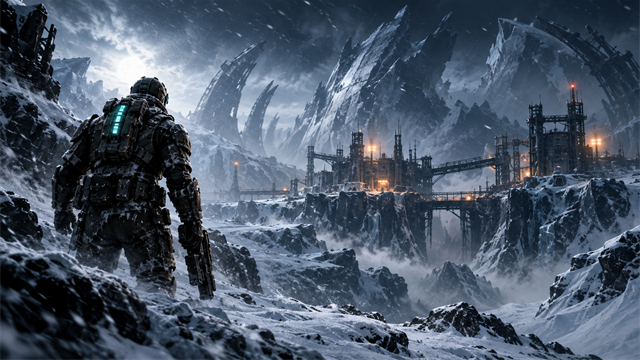

<p align="center">
  
</p>

# Dead Space 3 Vortex Extension


**Standalone Vortex support for Dead Space 3 on PC, by Rama2120.**
Discovers Steam, EA App/Origin, and custom installations across Windows drives.
Manages compatible DLL/INI/ASI mods, ReShade assets, whole-file VIV/VP6 replacements, and TexMod package files.

## Download

- [Nexus Mods](https://www.nexusmods.com/site/mods/2365)
- [Version 1.0.1 install ZIP](versions/v1.0.1/dead-space-3-vortex-extension-1.0.1.zip)
- [SHA-256 checksum](versions/v1.0.1/dead-space-3-vortex-extension-1.0.1.zip.sha256)

Version 1.0.1 adds numeric Nexus game ID **2728** for the current Vortex
catalogue process. Runtime code and artwork are identical to 1.0.0.

## Install

1. Install the ZIP from Vortex's **Extensions** page.
2. Restart Vortex when prompted.
3. Find **Dead Space 3** under Games and choose **Manage**.
4. Install, enable, and deploy compatible mods normally.

This is an extension for Vortex; do not install it into the game directory.
TexMod or another compatible loader still performs texture injection. Game files,
TexMod, and third-party mods are not included. See the full
[installation and troubleshooting guide](docs/INSTALLATION.md).

## Build and verification

On Windows with PowerShell and Node.js:

```powershell
.\tools\build.ps1
```

The packager checks metadata, JavaScript syntax, artwork, root ZIP entries,
extracted hashes, and the existing regression suite against the packaged source.
It writes the ZIP, test results, and checksum to `../outputs`.
See [BUILDING.md](BUILDING.md) and [release verification](docs/RELEASE-VERIFICATION.md).

Live Vortex deployment, EA/Origin discovery, and TexMod gameplay validation remain unverified; see the original release notes.
This metadata update does not establish new gameplay or store compatibility.

## Version archive

| Version | Package evidence | Source evidence | Notes |
| --- | --- | --- | --- |
| [0.1.0](versions/v0.1.0) | Original ZIP and checksum | Exact packaged source, extracted | Preserved unchanged. |
| [1.0.0](versions/v1.0.0) | Original ZIP and checksum | Exact packaged source, extracted | Preserved unchanged. |
| [1.0.1](versions/v1.0.1) | Current ZIP and checksum | Current source at repository root | Adds gameId; runtime unchanged. |

The original development chat is **Create Dead Space 3 extension**. Original packages retain their
bytes; extracted snapshots make their readable source browsable. Existing tests
and build tools from 1.0.0 are retained as a development snapshot. No separate
original source ZIP or older release was found, and no historical Git commits or
tags were reconstructed. [BACKUP_INVENTORY.md](BACKUP_INVENTORY.md) records
provenance and archive hashes.

## Credits and licensing

Created by Rama2120 with AI assistance. MIT licensed; see [LICENSE.txt](LICENSE.txt).
The artwork is original AI-generated atmosphere, not an official EA screenshot.
Unofficial community project, unaffiliated with Electronic Arts or Nexus Mods.
